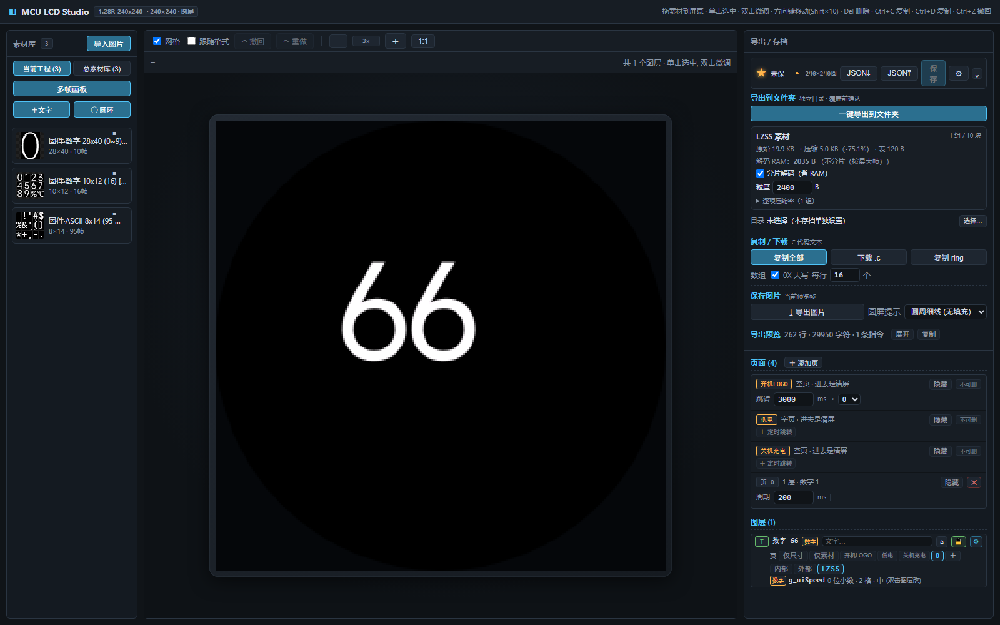
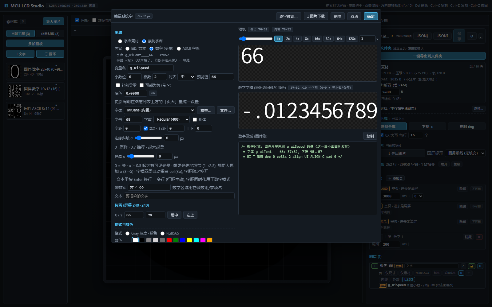
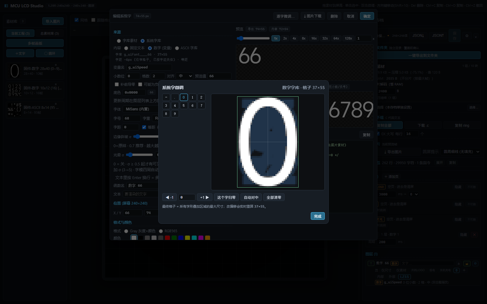
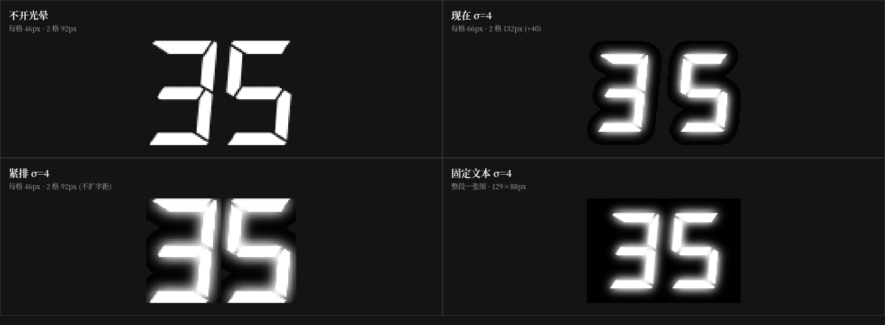

# MCU LCD Studio

**中文**：面向 MCU 小屏（GC9A01、ST7735S 等）的网页版 LCD 界面编辑器。拖放图片、文字、系统字、圆环和圆角矩形，按真实像素排版，直接导出 UI 表、字模、页面任务、LZSS 压缩素材和固件 C 代码。

**English**：A browser-based LCD UI editor for small MCU displays. Lay out images, text, system fonts, ring gauges and rounded panels at real pixel size, then export UI tables, glyphs, page tasks, LZSS-compressed assets and firmware C code.

仓库 / Repository：<https://github.com/Huyil/MCU-LCD-Studio>  
License：MIT



*上图：系统字数字 `66`、右侧 LZSS 素材统计和一键导出入口。*

---

## 1. 适合谁

- 用 MCU 驱动小尺寸 LCD，需要快速做页面、数字、图标和圆环的人；
- 不想手写帧表、字模数组、页面切换代码的人；
- 需要把 UI 资源压进内部 Flash，并控制解码 RAM 的人。

工具是纯前端 `Vue 3 + Vite`，没有后端。工程保存在浏览器 `localStorage`，也可以导入/导出 JSON。

---

## 2. 快速开始

```bash
git clone https://github.com/Huyil/MCU-LCD-Studio.git
cd MCU-LCD-Studio
pnpm install
pnpm dev            # http://127.0.0.1:5180
```

生产构建：

```bash
pnpm build
```

浏览器建议 Chrome / Edge。需要“直接写入文件夹”时使用 File System Access API；不支持的浏览器会自动回退为 ZIP 下载。

---

## 3. 五分钟做出第一屏

1. **导入素材**：左栏「导入图片」，或直接拖图片到中间屏幕。
2. **加文字/数字**：点「＋文字」。
   - 固定文本：选字体、字号、颜色；
   - 数字：选「数字」，绑定变量名，设置位数/小数位/对齐；
   - 系统字：选「系统字库」，按浏览器字体渲染，适合大号数字或中文。
   - **要用本文后面的示例渲染桥时，把这个数字层的存储切到「LZSS」**；新建图层默认是「内部」，内部导出只有 raw 字模，不会生成 `lzss_decode` / `ui_asset_draw`。
3. **加圆环/圆角矩形**：工具栏「圆环」，在右侧调范围、分段、颜色、扫描。
4. **看效果**：中间是 1:1 模拟屏，可缩放、拖动、对齐参考线。
5. **导出**：右栏「导出到文件夹」。
   - 选择固件源码目录，生成 `.c/.h`；
   - 不支持目录写入时下载 ZIP；
   - 导出前会显示 LZSS 压缩比和解码 RAM。

右侧「LZSS 素材」统计只算**走 LZSS 的图层/字库/字模**，不含内部/外部 raw，不能当作整个导出包的体积。

---

## 4. 导出后怎么在 MCU 里调用

这是最容易卡住的一步。下面按“网页导出 → 固件显示数字 66”走一遍。

### 4.1 文件放哪

网页导出按图层裁剪，不是每次都出全套。数字层切到 **LZSS** 时，核心生成物是：

```text
ui_table.c / ui_table.h      帧表、动态区域表、页面任务声明
ui_font.c                    字库描述、battery()/frames_1021() 等取图函数
ui_color.h                   颜色宏
ui_task.c / ui_task.h        页面任务
ui_assets_lzss.c / .h        LZSS 素材表 + 压缩流
lzss_decode.c / .h           通用 LZSS 解码
ui_asset_draw.c / .h         渲染桥：Frame/Ref/Asset/Glyph
ui_assets_int.c              内部 raw 素材（如果用了“内部”）
ui_assets_ext.c              外部 raw 素材（如果用了“外部”）
ring_config.h                圆环几何/段数/角度（无圆环也会生成，可忽略）
```

- `ui_assets_lzss.*`、`lzss_decode.*`、`ui_asset_draw.*` **只在工程含 LZSS 素材时生成**；
- 如果数字层保持「内部」，导出的是 `ui_assets_int.c` 里的连续 raw 字模，`ui_font.c` 的 `.glyph` 指向它；此时示例的 `app_ui.c`（依赖 `UI_DrawGlyph` / `UI_DrawFrameRefAt`）不能直接链接，需要自己接 raw 路径。第一次跑通请用 LZSS。

通用 UI 框架和屏幕驱动不在每次导出物里，直接使用示例工程：

```text
examples/render-port/
├─ code/spi/app_ui.c/.h          UI_DrawField / 数字差分
├─ code/spi/bsp_gc9a01.c/.h      LCD_Fill / LCD_drawImage / LCD_drawGrayImage
├─ code/spi/bsp_spiHost.c/.h     SPI 发送原语
├─ code/spi/app_lcd.c/.h         面板初始化/清屏/休眠
├─ code/timer/multi_timer.c/.h   页面定时器
└─ port/page0_port.c/.h          页 0 示例：数字/方向/电池/暂停
```

### 4.2 初始化

```c
/* 1. 目标板：时钟、GPIO、SPI */
Board_Init();

/* 2. 面板：复位、初始化、清屏 */
LCD_Init();                 /* examples/.../app_lcd.c */

/* 3. UI 表：注册 g_uiFields + UI_Init */
Page0Port_Init();           /* 内部调用 LCD_UI_Setup() */

/* 4. 进页 0：画静态帧、数字并启动页面定时器 */
Page0Port_Enter();          /* 内部调用 LCD_UI_Goto(0) */

/* 5. 主循环：必须持续跑，页面刷新/圆环都靠它 */
while (1) {
    timer_loop();
}
```

如果不用示例的 `page0_port`，最小初始化是：

```c
LCD_Init();
LCD_UI_Setup();
LCD_UI_Goto(0);
while (1) timer_loop();
```

### 4.3 显示系统字数字 66

网页里建一个「系统字库 + 数字」图层，绑定变量（示例是 `g_uiSpeed`），导出后会得到：

- `ui_font.c` 里的 `UI_FONT`（系统字渲染出的 54×80 字模，LZSS 左右两条）；
- `ui_table.c` 里的 `UI_FIELD`（2 格、居中、绑 `&g_uiSpeed`）。

固件里不需要单独的 `showNumber()`；`UI_DrawField()` 就是渲染函数：

```c
g_uiSpeed = 66;                       /* 你的业务变量 */
UI_DrawField(&g_uiFields[0]);         /* 立即画 66 */
```

**注意变量名**：`g_uiSpeed` 不是导出器凭空生成的。示例在 `ui_user.h` 里把 `UI_SRC_motor_speedlevel` 定义成 `&g_uiSpeed`；如果网页里绑定名写的是 `motor.speedlevel`，生成的表会要求 `motor` 结构体可见。第一次跑通用简单变量名（如 `g_uiSpeed`）并让 `ui_user.h` 指向它。

`Page0Port_SetLevel()` 是示例的档位包装，内部有 `PAGE0_MAX_LEVEL=35` 夹紧，**不要用它显示 66**；直接改 `g_uiSpeed` 再 `UI_DrawField`。

之后只要变量变化，页面定时器也会自动差分刷新：

```c
void LCD_Page0_CB(void *arg) {
    (void)arg;
    if (g_uiFields[0].drawn == 0 || g_uiSpeed != g_uiFields[0].last) {
        UI_DrawField(&g_uiFields[0]);
    }
}
```

`UI_DrawField` 内部按字符查字模，调用 `UI_DrawGlyph()`；`UI_DrawGlyph` 再按 `parts/partW` 逐片解压。业务层不用直接调用 `UI_DrawGlyph`。

### 4.4 需要对接的函数

只显示纯数字 66 时，**必须对接 4 个 UI/业务函数 + 3 个面板原语 = 7 个**；静态帧/电池会再多 2~3 个。SPI 层只有复用示例 `bsp_gc9a01.c` 时才需要。

| 层 | 函数 | 作用 |
|---|---|---|
| UI | `LCD_UI_Setup()` | 注册表并初始化，进页前调用一次 |
| UI | `LCD_UI_Goto(page)` | 切页；`0` 是示例页 |
| UI | `UI_DrawField(&g_uiFields[0])` | 画数字 / 动态区域 |
| UI | `UI_DrawFrame(id, color)` | 画静态帧（F/R、图标） |
| UI | `UI_DrawFrameRefAt(&ref, x, y, color)` | 画电池/多帧（按 `ref.index` 选帧） |
| UI | `timer_loop()` | 页面定时器、圆环、动画 |
| 面板 | `LCD_Init()` | 面板初始化 |
| 面板 | `LCD_Fill(x1,y1,x2,y2,color)` | 填充/清屏 |
| 面板 | `LCD_drawImage(x,y,w,h,px,color)` | RGB565 |
| 面板 | `LCD_drawGrayImage(x,y,w,h,px,color,mirror)` | GRAY8 + 乘色/镜像 |
| SPI | `SPI_BusTakeLCD()` / `SPI_BusRelease()` | 总线占用/释放 |
| SPI | `SPI_TransmitDC()` | DC 电平 + 命令/数据 |
| SPI | `SPI_TransmitU8` / `SPI_TransmitU16` | 命令/像素发送 |
| SPI | `SPI_TransmitU8GrayMultiplyColorMirror` | GRAY8 + 乘色 + 镜像 |
| SPI | `SPI_TransmitU16GrayMultiplyColor` | RGB565 乘色（`LCD_drawImage` 用） |
| SPI | `SPI_Fill_Transmit` | `LCD_Fill` 的批量填充 |

换屏/换 MCU 时，通常改 `examples/render-port/code/spi/bsp_gc9a01.*`、`bsp_spiHost.*`、`bsp_gpio.h`、`app_lcd.*`，以及 `code/timer/multi_timer.c` 里的 1ms 时基（示例用 `CW_BTIM1`）和 `bsp_gc9a01.c` 里的 SysTick `HAL_Delay`。`ui_*` 生成物和 `ui_asset_draw` 不用动。

### 4.5 多帧图标/电池

导出的 `ui_font.c` 会带业务函数，例如：

```c
battery(x, y, id, color, bg);     /* id 1..14 画第 1..14 帧，0 = 填底色 */
frames_1021(x, y, id, color, bg); /* 2 帧图标，id 1/2 */
```

也可以手动改 `UI_FRAME_REF.index` 后调用 `UI_DrawFrameRefAt`；`index == 255` 表示“只清底色”。

---

## 5. 系统字与逐字微调

系统字用浏览器字体渲染，字号随意，适合大号数字、中文和带光晕的效果。

- 在「＋文字」里选「系统字库」；
- 数字选「数字」并绑定变量；
- 标题栏「逐字微调…」可以按字符左右偏移，修 1px 抖动；
- 最终格子 = 所有字形叠加区域的最大尺寸；
- 偏移在导出时**烘进字模像素**，C 代码里没有 `glyphDx` 字段，固件不用改；改完要重新导出。
- 预览按当前颜色显示；导出的字模/图片仍是**白色或灰度掩膜**，颜色由 MCU 绘制时用 `color` 计算。



*「＋文字 → 系统字库 → 数字」，绑定 `g_uiSpeed`，预览值 66；右侧同时显示导出的字模表。*



*「逐字微调…」按字符修正 1px 抖动；最终格子取所有字形叠加区域的最大尺寸。*



---

## 6. 素材存储：内部 / 外部 / LZSS

每个图层三选一：

| 存储 | 去向 | 生成物 |
|---|---|---|
| 内部 | 内部 Flash `const uint8_t[]` | `ui_assets_int.c` |
| 外部 | 外部 Flash `const uint16_t[] + UI_EXT_RO` | `ui_assets_ext.c` |
| LZSS | 统一素材表 + 压缩流 | `ui_assets_lzss.c/.h` |

LZSS 表项：

```c
typedef struct {
    uint16_t off, clen;
    uint16_t w, h, y;
    uint8_t  fmt;      /* RGB565 / GRAY8 */
    uint8_t  flags;
} UI_Asset;
```

- 帧/图片分片只按行；字模左右条在字库层拆；
- `UI_ASSET_BUF_SIZE` 是实际最大片，4 字节对齐；
- `off/clen` 是 `uint16_t`，blob 必须小于 64 KB；
- 解码与渲染桥在 `lzss_decode.c` / `ui_asset_draw.c`，业务代码不用直接调用 `LZSS_Decode`。

更细的格式和移植契约见 [docs/lzss-format.md](docs/lzss-format.md)。

---

## 7. 示例工程

[`examples/render-port`](examples/render-port) 是一个可直接参考的页 0：

- 系统字数字 54×80（LZSS 左右两条）；
- F/R 方向图标（raw 灰度）；
- 电池 14 帧（RGB565）；
- K·RPM / PAUSE 两帧；
- 70 段圆环；
- GC9A01 面板驱动、SPI 驱动、页面定时器和 `page0_port` 适配层。

示例源文件包含 `lcd-project.json` 和字体，可重新导出替换。驱动是参考实现，换 MCU/屏幕时按目标工程改。

```c
g_uiSpeed = 66;                      /* 数字 66 */
UI_DrawField(&g_uiFields[0]);

Page0Port_SetDir(0);                 /* 0 = F，1 = R */
Page0Port_SetBattery(8);             /* 0 = 擦除，1..14 = 帧 */
Page0Port_SetPause(0, 0xFFFF);       /* 0 = K·RPM，1 = PAUSE */
```

`Page0Port_SetLevel()` 只接受 `0..35`，不要拿它显示 66。

---

## 8. 测试

```bash
pnpm check          # check:logic + check:ui
pnpm check:logic    # 21 组逻辑/导出/编译自检
pnpm check:ui       # 用 Vite SSR 渲染面板，防白屏
pnpm build
```

`check:export-keil.mjs` 需要 PATH 里有 `gcc`；它会真正编译生成物并跑一遍。

---

## 9. GitHub Pages

仓库带 `.github/workflows/pages.yml`，push `main` 后自动构建并发布到：

```text
https://huyil.github.io/MCU-LCD-Studio/
```

构建时 base 是 `/MCU-LCD-Studio/`；Pages 没有后端，在线存档不可用，本地 JSON / ZIP / 导出图片正常。

---

## 10. 文档与许可

- [docs/lzss-format.md](docs/lzss-format.md)：LZSS 表、字模 parts、渲染桥和移植接口；
- [examples/render-port](examples/render-port)：可直接对照的完整页 0；
- [SKILL.md](SKILL.md)：从网页建数字 66 到 MCU 显示的最短路径和函数清单；
- [docs/ui-export-redesign.md](docs/ui-export-redesign.md)：导出器设计细节。

MIT License，见 [LICENSE](LICENSE)。

---

## 11. 开源署名与字体来源

- **MultiTimer（legacy）**：Zibin Zheng，MIT，<https://github.com/0x1abin/MultiTimer/tree/legacy>；
  示例位于 `examples/render-port/code/timer/`，已按 CW32L011 的 1ms 时基修改。
- **MiSans**：© Xiaomi，来源 <https://hyperos.mi.com/font/>；网页内置的是 WOFF2 预览子集。
- **HarmonyOS Sans SC**：© Huawei，来源
  <https://developer.huawei.com/consumer/cn/doc/design-guides/font-0000001157868583>。
- **OPPO Sans 4.0**：© OPPO，来源 <https://www.coloros.com/>。
- **DSEG7 Classic**：keshikan，SIL OFL 1.1，来源 <https://github.com/keshikan/DSEG>；
  示例字体与 OFL 文本在 `examples/render-port/source/`。

完整版权/许可说明见 [THIRD_PARTY_NOTICES.md](THIRD_PARTY_NOTICES.md)。字体文件再分发前请以官方最新许可为准。
