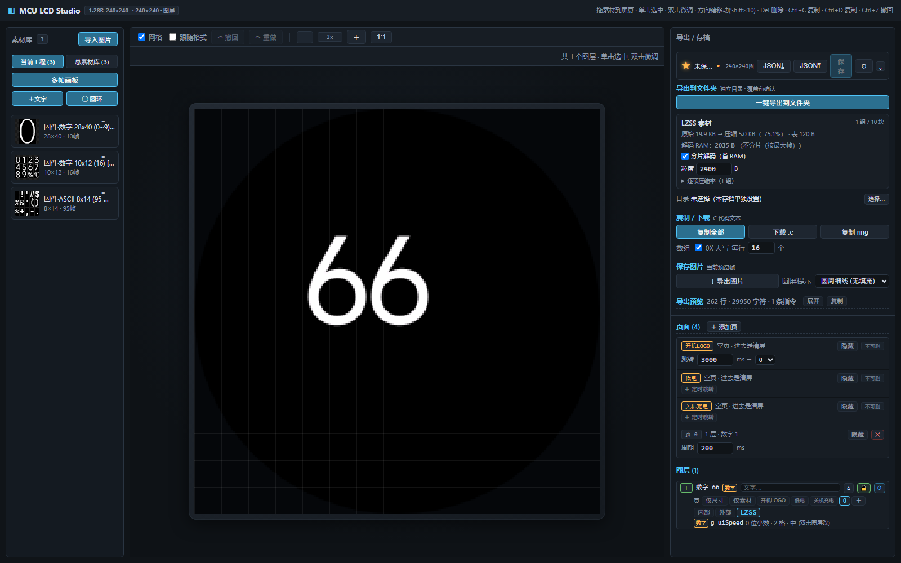

# Render port example

一个可直接对照的页 0 示例：系统字数字、F/R 方向、电池、K·RPM/PAUSE 和圆环。



它同时提供 **UI 框架 + 屏幕驱动 + SPI 驱动 + 页面定时器**，用于说明网页导出物在 MCU 侧怎么接起来。示例驱动是参考实现，换 MCU/屏幕时按目标工程替换。

## 目录

```text
examples/render-port/
├─ code/lcd/                     Web 导出物 + 通用渲染
│  ├─ ui_assets_lzss.c/.h        LZSS 素材表 + 压缩流
│  ├─ lzss_decode.c/.h           通用 LZSS 解码
│  ├─ ui_asset_draw.c/.h         渲染桥：Frame/Ref/Asset/Glyph
│  ├─ ui_assets_int.c            内部 raw 素材（F/R）
│  ├─ ui_font.c                  字库描述 + battery()/frames_1021()
│  ├─ ui_table.c/.h              帧表/动态区域表
│  ├─ ui_task.c/.h               页 0 任务
│  ├─ ui_color.h                 颜色宏
│  ├─ ui_user.h                  工程钩子（可改）
│  └─ ring_config.h              圆环参数
├─ code/spi/
│  ├─ app_ui.c/.h                UI_DrawField 差分渲染
│  ├─ bsp_gc9a01.c/.h            LCD_Fill/drawImage/drawGrayImage/Ring
│  ├─ bsp_spiHost.c/.h           SPI 发送原语
│  ├─ app_lcd.c/.h               面板初始化/清屏/休眠
│  ├─ bsp_ring.c/.h              圆环引擎
│  ├─ ring_tables.h / ring_grad.h   示例引擎自带，不由网页导出
│  ├─ bsp_gpio.h                 引脚宏（目标工程替换）
│  └─ bsp_w25q.h                 空桩
├─ code/timer/multi_timer.c/.h   页面定时器
├─ port/page0_port.c/.h          业务适配示例
└─ source/                       可选的 Web 工程源文件
```

## 最小接入

把 `code/lcd`、`code/spi`、`code/timer`、`port` 加入工程，并保证头文件路径包含：

```text
code/lcd
code/spi
code/timer
port
```

初始化：

```c
Board_Init();          /* 目标板：时钟/GPIO/SPI */
LCD_Init();            /* app_lcd.c：复位、清屏、DISPON */
Page0Port_Init();      /* LCD_UI_Setup() */
Page0Port_Enter();     /* LCD_UI_Goto(0) */

while (1) {
    timer_loop();      /* 页面刷新、圆环、动画 */
}
```

## 显示数字 66

示例数字层绑定 `g_uiSpeed`，`ui_table.c` 里是 `g_uiFields[0]`，字库是 `g_uiFont_g_uiField0`：

```c
g_uiSpeed = 66;
UI_DrawField(&g_uiFields[0]);
```

**不要**用 `Page0Port_SetLevel(66)`：示例的 `PAGE0_MAX_LEVEL=35`，会被夹成 35。`UI_DrawField` 就是数字的渲染入口；不需要额外的 `showNumber()`。它内部按字符调用 `UI_DrawGlyph`，再按 `parts/partW` 解压左右两条字模。

## 其他区域

```c
Page0Port_SetDir(0);                 /* 0 = F，1 = R */
Page0Port_SetBattery(8);             /* 0 = 擦除，1..14 = 帧 */
Page0Port_SetPause(1, 0xFFFF);       /* 1 = PAUSE，0 = K·RPM */
```

## 需要对接的接口

| 层 | 接口 | 说明 |
|---|---|---|
| 业务 | `Page0Port_*` | 示例适配层，可换成自己的业务 |
| UI | `LCD_UI_Setup` / `LCD_UI_Goto` | 注册表 + 进页 |
| UI | `UI_DrawField` | 数字/动态区域 |
| UI | `UI_DrawFrame` / `UI_DrawFrameRefAt` | 静态帧 / 多帧 |
| UI | `timer_loop` | 页面定时器 |
| 面板 | `LCD_Init` | 初始化 |
| 面板 | `LCD_Fill` | 填充/清屏 |
| 面板 | `LCD_drawImage` | RGB565 |
| 面板 | `LCD_drawGrayImage` | GRAY8 + 乘色/镜像 |
| SPI | `SPI_BusTakeLCD` / `SPI_BusRelease` | 总线占用/释放 |
| SPI | `SPI_TransmitDC` | DC 电平 + 命令/数据 |
| SPI | `SPI_TransmitU8` / `SPI_TransmitU16` | 命令/像素 |
| SPI | `SPI_TransmitU8GrayMultiplyColorMirror` | GRAY8 + 乘色 + 镜像 |
| SPI | `SPI_TransmitU16GrayMultiplyColor` / `SPI_Fill_Transmit` | RGB565 乘色 / 批量填充 |

## 换屏 / 换 MCU

通常只改：

- `code/spi/bsp_gc9a01.c/.h`：面板初始化、窗口命令、像素发送；
- `code/spi/bsp_spiHost.c/.h`：SPI 总线；
- `code/spi/bsp_gpio.h`：CS/DC/RST/BL 引脚；
- `code/spi/app_lcd.c/.h`：清屏/休眠/唤醒；
- `code/timer/multi_timer.c`：1ms 时基（示例读 `CW_BTIM1`）；
- `port/page0_port.c`：业务状态来源。

`ui_assets_*`、`ui_table`、`ui_font`、`lzss_decode`、`ui_asset_draw` 是导出物/通用代码，不随屏幕变化。

## 重新导出

`source/lcd-project.json` 是网页工程源文件。改完重新导出后，替换 `code/lcd` 下的：

```text
ui_assets_lzss.c/.h  ui_assets_int.c  ui_font.c  ui_table.c/.h
ui_color.h  ui_task.c/.h  ring_config.h  ring_scan.h/.c
```

`ring_tables.h` / `ring_grad.h` 是示例圆环引擎自带的表，不由网页导出；换圆环参数时按引擎的生成方式处理，不要指望一键导出覆盖它们。

**不要覆盖** `code/lcd/ui_user.h` 和 `port/page0_port.c`。
